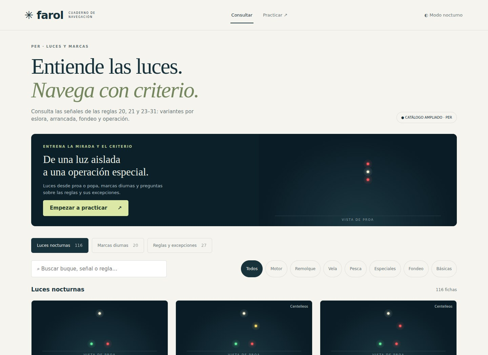
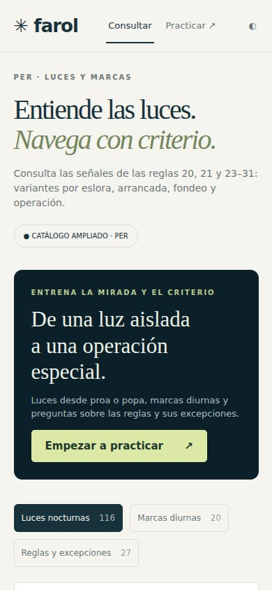

# Farol · Llums de navegació

Estudia els llums, les marques i les regles de navegació amb fitxes i exercicis.

**[Obre el PWA / Open app](https://guirigall.github.io/LlumsNavegacio/)** · [Guia completa](docs/guia-completa.md) · [Incidències](https://github.com/Guirigall/LlumsNavegacio/issues)

[Català](#ca) · [Español](#es) · [English](#en)



<details>
<summary>Vista en mòbil / Mobile view</summary>



</details>

<a id="ca"></a>

## Català

Estudia els llums, les marques i les regles de navegació amb fitxes i exercicis.

### Què hi trobaràs

- Catàleg de llums nocturns, marques diürnes i regles.
- Pràctica de llums exclusivament des de proa i popa.
- Quatre opcions de resposta amb explicació posterior.
- Progrés local i funcionament sense connexió; interfície en espanyol.

### Comença

Consulta les fitxes o obre el mode de pràctica. Les preguntes de llums no mostren vistes laterals ni obliqües; la consulta conserva el selector de punts de vista.

### Instal·lació

Obre l’aplicació amb HTTPS. A Android, fes servir Chrome → ⋮ → **Instal·la l’aplicació** o **Afegeix a la pantalla d’inici**. A iPhone: Safari → Compartir → **Afegeix a la pantalla d’inici**. Espera la confirmació de preparació sense connexió abans d’utilitzar el mode avió. No cal APK ni sideloading.

### Dades i límits

Disponible sense connexió després de completar la primera càrrega. És material didàctic simplificat; no substitueix el RIPA ni la vigilància a bord.

<a id="es"></a>

## Español

Estudia luces, marcas y reglas de navegación con fichas y ejercicios.

### Qué ofrece

- Catálogo de luces nocturnas, marcas diurnas y reglas.
- Práctica de luces exclusivamente desde proa y popa.
- Cuatro respuestas posibles con explicación posterior.
- Progreso local y funcionamiento sin conexión; interfaz en español.

### Primeros pasos

Consulta las fichas o abre la práctica. Las preguntas de luces no incluyen vistas laterales ni oblicuas; la consulta conserva el selector de puntos de vista.

### Instalación

Abre la aplicación por HTTPS. En Android: Chrome → ⋮ → **Instalar aplicación** o **Añadir a pantalla de inicio**. En iPhone: Safari → Compartir → **Añadir a pantalla de inicio**. Espera la confirmación de disponibilidad sin conexión antes de usar el modo avión. No necesita APK ni sideloading.

### Datos y límites

Disponible sin conexión tras completar la primera carga. Es material didáctico simplificado; no sustituye al RIPA ni a la vigilancia a bordo.

<a id="en"></a>

## English

Study navigation lights, day shapes and rules using reference cards and exercises.

### Features

- Night-light, day-shape and rule reference cards.
- Light questions use bow and stern views only.
- Four answer choices followed by an explanation.
- Local progress and offline use; Spanish interface.

### Getting started

Browse the reference cards or start practice. Light questions exclude side and oblique views; the reference view retains its angle selector.

### Installation

Open the HTTPS app URL. On Android: Chrome → ⋮ → **Install app** or **Add to home screen**. On iPhone: Safari → Share → **Add to Home Screen**. Wait for offline readiness before using airplane mode. No APK or sideloading is required.

### Data and limitations

Available offline after the first complete load. Simplified educational content does not replace COLREGs or keeping a lookout.

## Desenvolupament / Development

Des de la carpeta del repositori, amb Python 3 / From the repository folder, with Python 3:

```bash
python3 -m http.server 8080 --bind 127.0.0.1
```

Obre / Open `http://localhost:8080/`. Per instal·lar-lo des del mòbil, utilitza l’enllaç HTTPS del PWA.

Comprovacions incloses al repositori / Checks included in this repository:

```bash
node tests/practice.cjs
```

Les captures es generen amb Chromium a partir del codi real del repositori, en contextos sense dades personals. Es poden renovar a **Actions → Captures del README → Run workflow**. Més detalls a [la guia completa](docs/guia-completa.md).
